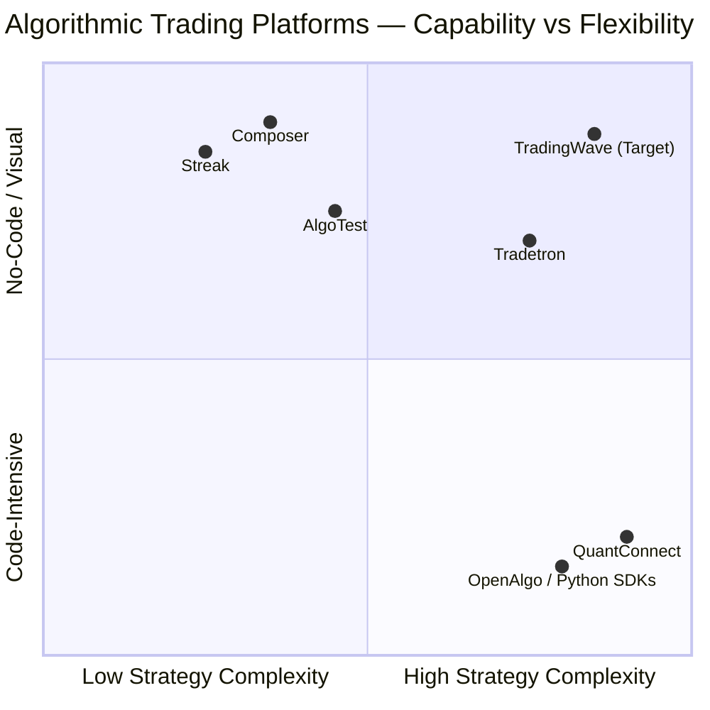

# Competitor & Market Positioning Analysis
**Classification:** `VERIFIED` (Market Data) & `PROPOSED` (TradingWave Strategy)

---

## 1. Competitive Landscape Overview

In the Indian and South-Asian algorithmic trading ecosystem, retail and semi-institutional traders navigate between code-heavy frameworks (QuantConnect, Backtrader) and rigid no-code platforms (Streak, AlgoTest).

---

## 2. Comparative Feature Matrix

| Feature | Tradetron `[VERIFIED]` | AlgoTest `[VERIFIED]` | Streak `[VERIFIED]` | TradingWave `[PROPOSED]` |
|---|---|---|---|---|
| **Multi-Leg Options Builder** | ✅ Yes (Advanced Wizard + Sets) | ✅ Yes (Options Focus) | ⚠️ Limited | ✅ Advanced Visual Canvas + Options Engine |
| **Repair / Adjustment Rules** | ✅ Highly flexible | ❌ Limited adjustments | ❌ No | ✅ Comprehensive Set & Leg-Level Repair Rules |
| **Broker Support (India)** | ✅ 38+ Brokers | ⚠️ ~15 Brokers | ⚠️ Limited to Kite/Angel | ✅ 40+ Direct Adapters via Open Broker Interface |
| **Crypto Options Support** | ✅ Delta Exchange, CoinDCX | ❌ Equities/F&O only | ❌ None | ✅ Delta Exchange, CoinDCX, Binance, OKX |
| **TradingView Webhooks** | ✅ Yes (PineBridge) | ⚠️ Basic Webhook | ❌ No | ✅ PineBridge Native Schema + Webhook Ingest |
| **Execution Safety** | ⚠️ Known slippage/timeout lags | ✅ Fast execution | ✅ Clean broker integration | ✅ Distributed Sub-Second Rust/Node OMS |
| **Modern Developer API** | ❌ Legacy PHP endpoints | ⚠️ Internal APIs | ❌ None | ✅ Complete OpenAPI 3.1 + Webhooks + SDK |
