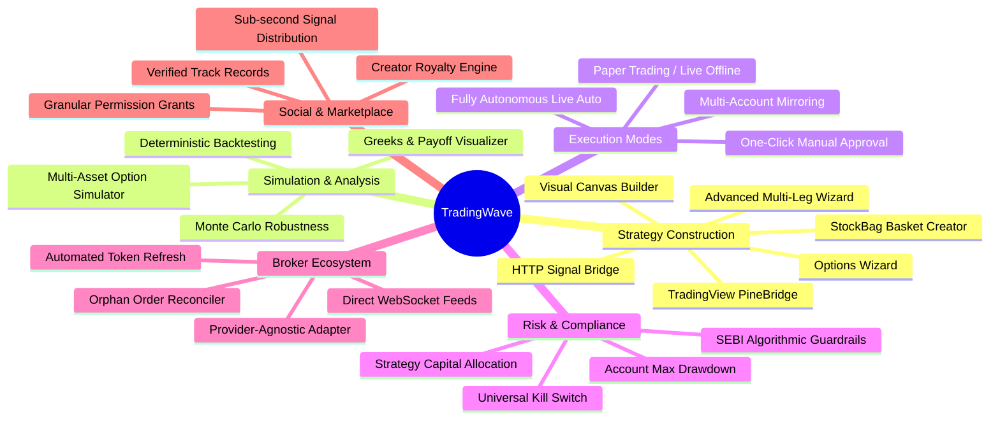

# TradingWave — Product Capabilities Inventory
**Classification:** `PROPOSED` & `VERIFIED`

---

## 1. Capabilities Matrix

TradingWave delivers end-to-end capabilities across 6 operational domains:

---

## 2. Detailed Capability Breakdown

### A. Strategy Creation
- **Visual Strategy Canvas:** Drag-and-drop rule assembly with nested AND/OR logic groups.
- **214+ Math & Market Keywords:** Full functional compatibility with Tradetron keyword grammar including technical indicators, option Greeks, positional MTM, time/calendar triggers, and math transforms.
- **Options Leg Model:** Dynamic strike selection (ATM offsets, Delta targeting, IV targeting, Premium range targeting) across weekly and monthly expiries.
- **Repair Conditions:** Leg-level and set-level adjustment rules (e.g., rolling untested spreads, hedging delta divergence).

### B. Execution Engines
- **Paper Trading (Live Offline):** Simulated order fills against live WebSocket tick feeds with configurable latency and slippage models.
- **Live Auto Execution:** Direct broker routing via authenticated REST/WebSocket adapters with sub-second execution latency.
- **Execution Safeguards:** Automated re-quote on partial fills, strike rounding verification, lot size enforcement, and freeze-quantity slicing.
