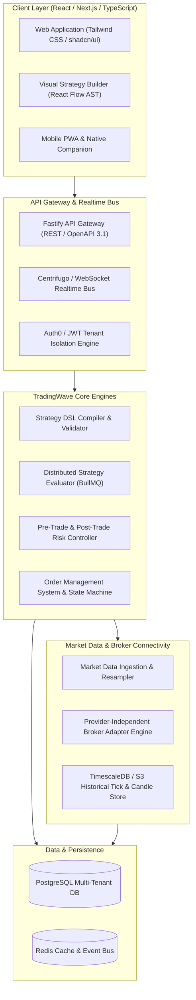

# TradingWave — Project Overview
**Classification:** `PROPOSED` (System Architecture) & `VERIFIED` (Reference Context)
**Target Reference:** Tradetron (https://tradetron.tech/)
**Date:** 2026-11-20
**Author:** Principal Trading Systems Architect & Full-Stack Engineering Team

---

## 1. Executive Summary

**TradingWave** is an enterprise-grade, multi-broker algorithmic trading platform and strategy automation SaaS. It is designed to empower retail traders, quantitative developers, and commercial strategy creators to build, backtest, paper-trade, and deploy multi-asset algorithmic strategies across Indian and global equity, derivatives, and digital asset markets without requiring proprietary code execution in production.

### Brand Identity & Tagline
- **Platform Name:** TradingWave
- **Brand Slogan:** *TRADE BINDAS*
- **Visual Identity:** Modern high-contrast dark-mode interface powered by bold trading orange (`#FF6600`), deep slate background (`#0F172A`), crisp neutral cards (`#1E293B`), and institutional financial data typography.

```
       ████████╗██████╗  █████╗ ██████╗ ██╗███╗   ██╗ ██████╗ ██╗    ██╗ █████╗ ██╗   ██╗███████╗
       ╚══██╔══╝██╔══██╗██╔══██╗██╔══██╗██║████╗  ██║██╔════╝ ██║    ██║██╔══██╗██║   ██║██╔════╝
          ██║   ██████╔╝███████║██║  ██║██║██╔██╗ ██║██║  ███╗██║ █╗ ██║███████║██║   ██║█████╗  
          ██║   ██╔══██╗██╔══██║██║  ██║██║██║╚██╗██║██║   ██║██║███╗██║██╔══██║╚██╗ ██╔╝██╔══╝  
          ██║   ██║  ██║██║  ██║██████╔╝██║██║ ╚████║╚██████╔╝╚███╔███╔╝██║  ██║ ╚████╔╝ ███████╗
          ╚═╝   ╚═╝  ╚═╝╚═╝  ╚═╝╚═════╝ ╚═╝╚═╝  ╚═══╝ ╚═════╝  ╚══╝╚══╝ ╚═╝  ╚═╝  ╚═══╝  ╚══════╝
                                     —  T R A D E   B I N D A S  —
```

---

## 2. Core Strategic Objectives

1. **Deterministic No-Code Strategy Builder:** Enable complex multi-leg algorithmic construction via nested Boolean logic (AND/OR), mathematical transforms, positional checks, and multi-timeframe technical indicators, compiled into a sandboxed, strictly typed Abstract Syntax Tree (JSON AST).
2. **Provider-Agnostic Broker Abstraction:** Provide uniform API connectivity across 30+ leading Indian stockbrokers (Zerodha Kite, Dhan, Angel One SmartAPI, Groww, Fyers, Upstox, Kotak Neo, Finvasia Shoonya, etc.) and crypto exchanges (Delta Exchange, CoinDCX) with zero broker lock-in.
3. **Institutional Execution & Risk Guardrails:** Multi-layered risk engine enforcing pre-trade checks, max drawdown square-offs, kill-switches, price-collar slippage controls, order rate limits, and orphan order reconciliation.
4. **Deterministic Backtesting Engine:** Zero-lookahead bias event-driven simulation engine modeling realistic slippage, exchange STT/transaction charges, GST, SEBI turnover fees, stamp duty, bid-ask spread expansion, and contract rollover costs.
5. **Multi-Tenant SaaS & Strategy Marketplace:** Scalable multi-tenant architecture with role-based access control (RBAC), end-to-end token encryption, copy trading, creator revenue sharing, and real-time subscriber sync.

---

## 3. High-Level Architecture Synopsis



---

## 4. Key Differences from Reference Product (Tradetron)

| Architectural Dimension | Reference Product (Tradetron) `[VERIFIED]` | TradingWave Target Architecture `[PROPOSED]` |
|---|---|---|
| **Backend Framework** | PHP / Laravel monolith with Python Scipy worker microservices | High-throughput Node.js Fastify modular monolith + Rust/Go execution core |
| **Strategy Representation** | Procedural relational tables + eval-based positional calculations | Formally typed, versioned JSON Abstract Syntax Tree (AST) with Zero-Eval guarantees |
| **Realtime Infrastructure** | Centrifugo (`centrifuge.js`) + standard polling fallback | Centrifugo bidirectional WebSockets + Redis Pub/Sub cluster with instant failover |
| **Broker Security** | Database-stored tokens with server-side key decryption | Envelope encryption using AWS KMS / HashiCorp Vault; broker credentials never logged |
| **Backtesting Model** | Daily/1-minute batch simulation with standard bar fills | Event-driven tick-accurate simulation with volume-weighted order book matching |
| **UI/UX Experience** | Legacy multi-page form controls with day/night switch | Modern high-density SPA (Next.js 15, Tailwind CSS, shadcn/ui, TradingView Lightweight Charts) |
