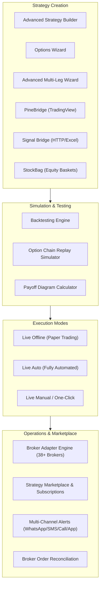

# Tradetron Feature Inventory
**Classification:** `VERIFIED` (Direct Observation & Runtime Analysis)

---

## 1. Comprehensive Feature Matrix

### Feature Categories:
1. **Rule-Based Engine:** Multi-set architecture with independent Entry, Repair (Set Repair & Leg Repair), and Exit condition blocks.
2. **Options Leg Engine:** Strike calculation offsets based on ATM, ATM Spot, Points offset, Delta offset, and Fixed strikes.
3. **Multi-Timeframe Evaluation:** Support for tick-level, 1-min, 3-min, 5-min, 15-min, 30-min, 60-min, and Daily candle intervals.
4. **Broker Token Handling:** Daily auto-login triggers, TOTP authenticators, and manual session renewal alerts.
