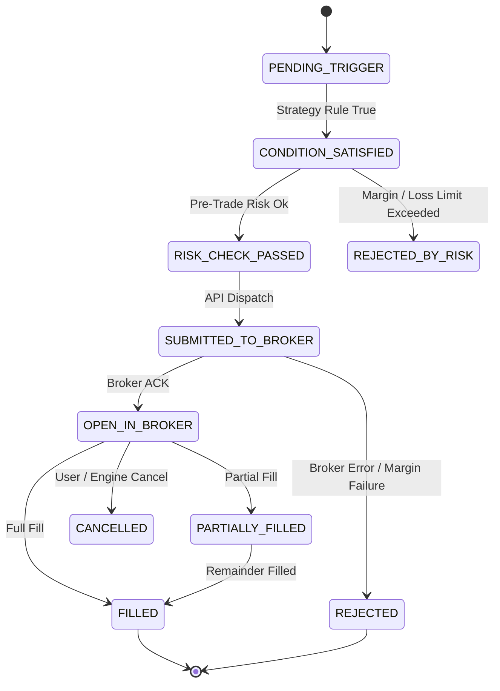

# Live Execution & Broker Connectivity Analysis
**Classification:** `VERIFIED` (Tradetron Models) & `PROPOSED` (TradingWave Engine)

---

## 1. Execution Modalities

1. **Live Offline (Paper Trading):** Evaluates live real-time market data ticks. Simulates fills against real-time LTP with virtual order books. Perfect for forward testing without capital risk.
2. **Live Auto (Automated Execution):** Fully autonomous order placement directly to client's connected broker account via REST APIs.
3. **Live Auto - One Click:** Sends real-time push alert requiring trader manual confirmation tap before dispatching order to broker.

### Order State Transitions:

