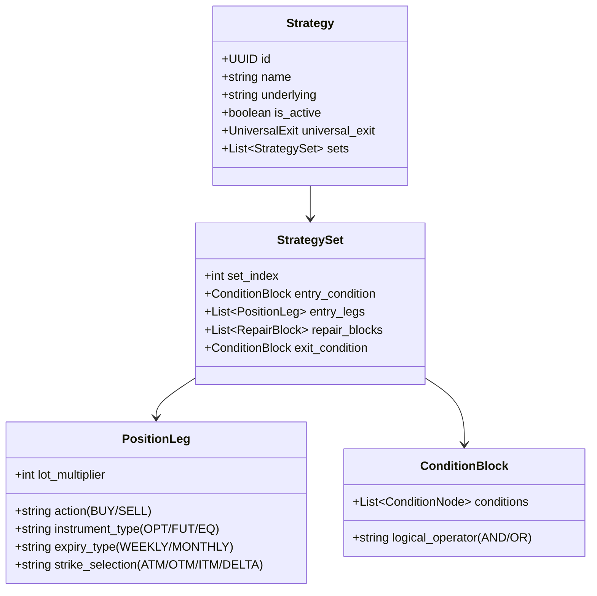

# Strategy Builder Deep Investigation
**Classification:** `VERIFIED` (Production Assets & DOM Analysis)

---

## 1. Structural Anatomy of a Strategy

In the reference architecture, a strategy is hierarchically composed of:
1. **Strategy Level Metadata:**
   - Strategy Name, Description, Tags, Category.
   - Default Underlying (e.g. NIFTY 50, BANKNIFTY, RELIANCE).
   - Execution Settings (Continuous check vs Candle close check, check frequency).
2. **Strategy Sets (1 to N):**
   - Each Set operates as an independent logical trading idea.
   - **Entry Condition Block:** Boolean expression tree determining when to initiate positions.
   - **Positions / Legs Block:** Instruments to Buy/Sell when Entry condition evaluates to True.
   - **Repair Condition Blocks:** Conditional logic to hedge, roll, or adjust active positions.
   - **Exit Condition Block:** Conditions to square off all positions belonging to this Set.
3. **Universal Exit Condition:**
   - Global failsafe condition evaluated across all sets (e.g. Total Strategy PnL <= -5000 OR Time >= 15:20).
4. **Universal Trailing Stop Loss (Universal Exit TSL):**
   - Activates trailing exit when strategy reaches target profit threshold.

