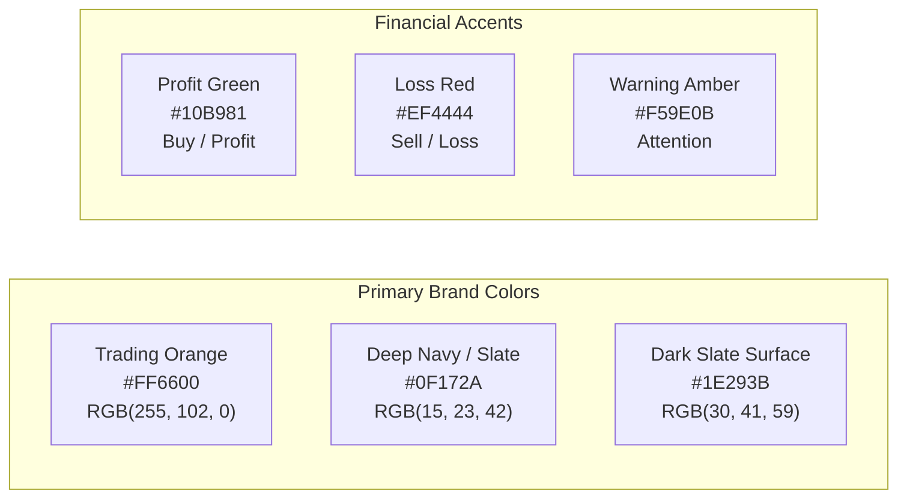

# TradingWave Design System & Visual Identity
**Classification:** `PROPOSED` (TradingWave Identity) & `VERIFIED` (Logo Reference)

---

## 1. Brand Tokens & Color Palette

Based on the official TradingWave logo (`tradingwave_logo.jpg`) with the brand motto **"TRADE BINDAS"**:

### Color Variables (Tailwind CSS / CSS Variables):
- `--primary`: `#FF6600` (TradingWave Vibrant Orange)
- `--primary-hover`: `#E65C00`
- `--background`: `#0B0F19` (Dark institutional backdrop)
- `--card`: `#131B2E` (High-contrast container)
- `--card-border`: `#1E293B`
- `--foreground`: `#F8FAFC`
- `--muted-foreground`: `#94A3B8`
- `--profit`: `#10B981` (Emergent green)
- `--loss`: `#EF4444` (Vibrant alert red)

---

## 2. Typography

- **Display & Headings:** `Plus Jakarta Sans` or `Inter` (Weights: 600 Semi-Bold, 700 Bold)
- **Data & Tables / Tickers:** `JetBrains Mono` or `Roboto Mono` (Tabular numbers for currency alignment)
- **Body & Prose:** `Inter` (Weights: 400 Regular, 500 Medium)
