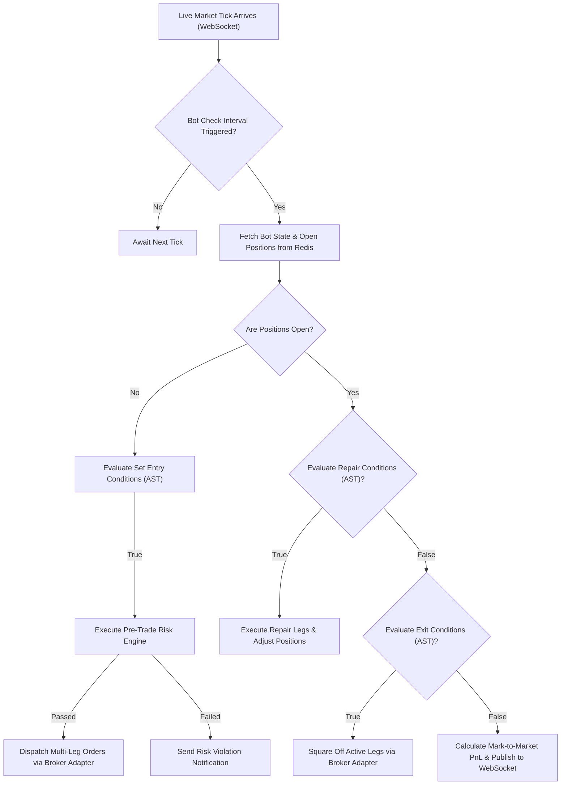

# Strategy Execution Engine Specification
**Classification:** `PROPOSED`

---

## 1. Condition Evaluation Loop

The Execution Engine continuously processes deployed strategy bots through an event-driven worker loop:

